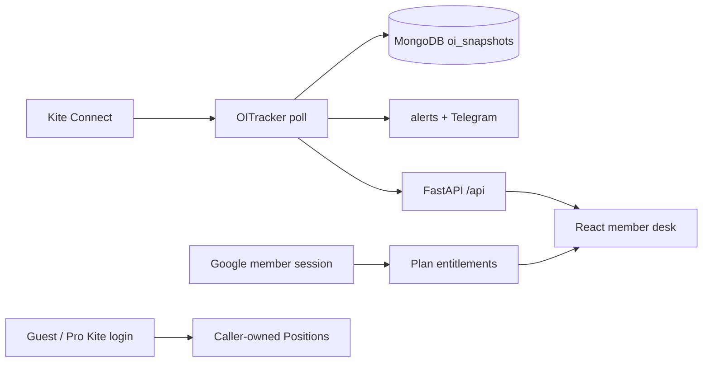

# StrikLenz — architecture

## System overview

StrikLenz is a **publisher-polled open-interest desk** for Indian index options. A FastAPI process uses one Zerodha Kite Connect token to poll option chains, upsert strike-level snapshots in MongoDB, and serve a React desk. Guests never share that token for their book.



## Frontend

- Entry: `frontend/src/pages/Dashboard.jsx` (active index, OI cache, tabs).
- Public showcase: `frontend/src/pages/SiteWalkthrough.jsx` gates an anonymous
  `/sitewalkthrough` route, then mounts the real `Dashboard.jsx` in demo mode.
  Route isolation recognizes case and percent-encoded variants as well, matching
  React Router's route behavior.
  `lib/siteWalkthroughApi.js` supplies fictional fixtures through an Axios
  adapter scoped to this pathname; dashboard reads do not reach the backend,
  and writes are held in memory. The only backend request is the public
  `/auth/state` availability check. Raw spot and straddle WebSockets are
  disabled; CAS and admin-only surfaces remain hidden.
  The walkthrough starts with the slim header without changing the visitor's
  saved normal-desk header preference.
  Synthetic index quotes, OI, options, and straddles share a deterministic
  clock and follow regular 09:15–15:30 IST NSE hours, with published
  special-session hours honored; closed markets hold the prior final sample.
  Fixture-backed market-only Desk AI context, a fictional local journal, and
  stable-cadence sample alerts are labelled. The demo never fetches Admin
  trade-cycle settings; journal edits remain in memory.
  Admins control availability from either Admin Settings or the dashboard
  Admin toggle; both write the same saved setting. When disabled, public
  landing-page demo links are hidden and direct walkthrough access stops at
  the public auth-state check without mounting the demo dashboard.
- Positions: `PositionsPanel.jsx` + `PositionsAnalyzeModal.jsx` + `PositionsBrainPanel.jsx` (Admin-only short-book guidance in `lib/positionsBrain.js`). Members see their own positions and neutral risk-factor summaries; actionable book guidance remains on the Admin desk. The internal Risk Management view uses the same enriched open-position rows and poll lifecycle; scenario calculations live in `lib/positionsRisk.js`.
- Market Intel popup polls the user's already-scored `/market-intel/popup` candidates. It suppresses the existing queue on first load, then alerts once per newly appearing event cluster; foreground users get an in-app toast and opted-in users get the existing OS notification when the page is backgrounded. It does not create a separate news source or market signal.
- Market Intel and Overnight Hold floating panels are desktop-resizable; each user's dimensions persist in browser local storage and are clamped to the viewport. Phone sheets remain full-width and viewport-bounded.
- During the configured CAS indicative-price window, the sidebar shows both NIFTY and SENSEX indicative quotes above the Expiries Included list, independent of the currently selected OI index.
- Market Intel outcome evaluation runs on its own 60-second worker tick and reads retained `oi_snapshots` only. News-source requests remain gated by their configured cadence. A dedicated Google News source covers India-linked international company developments, while material mentions of uploaded NIFTY / SENSEX constituents receive additional India relevance during scoring. Evaluations are keyed to the existing event cluster, so related headlines contribute one outcome sample. Direction results include empirical hit rates by heuristic-strength band; separate VIX / per-index realized-range comparisons are also grouped by catalyst and hidden until minimum samples exist.
- Market Intel maps current-day, source-backed company stories to uploaded constituent weights for NIFTY, BANKNIFTY, and SENSEX; broad India-linked macro, oil, and geopolitical catalysts are mapped to all three. In addition to broad feeds, the ingest worker maintains public Google News queries targeting results/material events for each index's 12 highest-weight uploaded constituents, within the existing source cadence. `/market-intel/index-risk` derives a daily exposure summary from retained `mi_articles`, `index_constituents`, and the NSE event calendar without a new poller or collection. It exact-matches scheduled quarterly-result companies to direct-company headlines, labels result-news found / company-news-only / no matching news, and reports whether the calendar is stale or missing; no matching story is not treated as proof that no result was published. The exposure score is heuristic, not a probability; direction remains tentative. The UI prioritizes risk, direction, scheduled result coverage, and the leading headline, with evidence details collapsed by default. Market Intel articles and its existing per-user popup carry the same index mapping, and Index Risk reuses the summary only when the user can access Market Intel.
- Desk AI and the carry brief request `/oi/{index}/change` only while `/market/status` reports `is_oi_polling: true`; missing status fails closed, preventing repeated after-hours OI requests while retaining the Dashboard's separate last-session display.
- Domain JS: `frontend/src/lib/` — `universe.js`, `positionPayoff.js`, `holidays.js`, `journalYearHeat.js`.
- Trade Journal archive imports are parsed and held in browser-tab memory; the imported cycle-ledger calendar is visibly separate from saved `trade_journal` P&L and never posts archive contents to the API.
- HTTP: `frontend/src/lib/api.js` (axios, admin/guest headers).
- Membership screens: `AccountSettings.jsx` owns member preferences and billing, `MemberJournal.jsx` writes caller-scoped Pro journal rows, and `AdminSubscriptions.jsx` is the admin member-control surface. Admin plan configuration is separate from Public guest access.
- Razorpay cancellation is immediate: cancellation, payment failure, and terminal/non-active provider lifecycle events remove paid entitlement and set the member plan to Basic. Admin subscription health derives current accessible plan counts from member records and all-time billing totals from deduplicated `billing_events`.
- Basic is the public label for the backward-compatible `normal` plan ID. Auth state reports whether a member's assigned plan is enabled; disabled-plan members retain account access but are directed to `/account` and only currently available paid plans.
- Admin plan pricing supports optional first-period prices per paid-plan cadence. Checkout attaches that cadence's Razorpay offer ID and stores/returns the configured first-period price; Admin must verify in the Razorpay Dashboard that the provider offer is a single-use flat discount equal to regular price minus offer price, with offer failure set to block payment. The provider API does not expose offer terms for this checkout to compare automatically, so the app only verifies the matching ID is present. Later subscription cycles retain the regular Razorpay plan amount.
- Admin Settings → Google Sign-In stores the guest-login flag separately from Google OAuth readiness and the timed Public-access window. Guest sign-in defaults off; the API enforces the setting for guest entry and pending-approval token polling, while existing guest sessions remain governed by Public access.
- Admin Settings → Public entry connection controls the retry-screen wait (5–60 seconds, default 10). The public `/api/public/boot-config` response contains only this non-sensitive duration; the frontend fetches it in parallel with `/api/auth/state` so configuration does not add a sequential request delay.
- Landing-page display is managed at `/admin/settings/landingpage`; section/card visibility is served by `/api/public/site-config`. The broker directory is hidden by default, and its marketing switches do not control broker OAuth integrations or member entitlements.
- Landing-page section text, navigation labels, feature-card copy, FAQ entries, plan marketing descriptions, and screenshot titles are editable from Admin Settings → Landing Page. The editor saves only bounded, allowlisted public copy; membership entitlements, prices, and live feed behavior remain configured separately. The Pro showcase uses a clearly fictional, compact PositionMeter mockup in place of the Desk AI preview; this does not change Pro access to Desk AI. The public landing page uses smooth anchor navigation with an active-section indicator, with reduced-motion preferences respected. If the Admin holiday-upload endpoint is unavailable, the plan preview uses the app's built-in NSE holiday calendar rather than fictional dates.
- The landing-page “Step inside the terminal” carousel opens on Straddle, Strike Pressure, and Trade Journal in that order; remaining previews retain their order. Strike Pressure uses the app's centered session-bias bar presentation over fictional sample snapshots and remains clearly labeled as illustrative, without changing dashboard pressure behavior.
- The public landing ticker refreshes the shared `/tickers` feed for the three core indices and all Admin-enabled indices, plus `/tickers/extras` for India VIX and GIFT NIFTY. Those five symbols remain in the display even when a quote is unavailable; unavailable numbers are shown as dashes, never as invented live prices. It refreshes at the dashboard's 60-second cadence. The strip sits 25px below the hero; the hero clips horizontal overflow only and reserves bottom clearance so the floating animated preview's full shadow remains visible.
- Landing-page OI sample metadata labels the illustrative expiry as 28 Sep · Monthly. The hero eyebrow says “Live options intelligence” without repeating index names. Desk AI marketing copy describes its consolidated view across Market Intel, Global Markets and Indian index movers; only exact legacy default copy is migrated, so custom Admin copy remains intact.
- Fictional OI charts in the landing-page product and plan previews show 11 strikes around ATM for readability. Admin-captured chart previews retain their complete captured strike range; the live dashboard is unaffected.
- Admin Settings → Landing Page also controls the global plan **More info** visibility. When disabled, public pricing cards omit the details buttons and the public plan-preview and screenshot endpoints return 404; plan prices and member entitlements are unchanged.
- The public landing feature grid highlights Full Option Chain, Strike Pressure, Global Markets, Straddle, Market & Global Events, and Desk AI under “Everything the desk needs, in one view.” The former OI Distribution card is removed; its saved visibility migrates to the replacement Straddle and Events cards. The product demo includes clearly labeled illustrative Straddle and Market & Global Events previews.
- Public plan **More info** dialogs fetch selected entitled features and one sanitized, Admin-captured shared-data snapshot from `/api/public/landing-plan-preview/{plan}` only when opened. The snapshot lives under `settings.landing_page.plan_demo_snapshot` and remains static until the Admin explicitly refreshes it. Captured sources are publisher OI, straddle, index events, exchange holidays, Market Intel, Global Markets, the publisher's shared alert tape, and a whitelisted heavyweight cash tape for Desk AI (constituent, index, weight, move, breadth, source, and timestamp only). A missing or empty feed is illustrated with visibly labeled fictional sample data, never presented as live. Member alert inboxes, preferences, broker credentials, positions, private journals, and trade cycles are excluded. Positions and journal examples stay local and fictional. Desk AI uses shared-market context only and never accesses, analyzes, or comments on member positions. Feature order and copy are Admin-configurable; optional screenshots remain supporting illustrations.
- Public plan previews distinguish OI Change, Open Interest, Strike Table, Build-up, and Straddle. Build-up examples show neutral OI/price measurements without directional labels; Index Risk shows event dates and supplied index weight, not a generated risk score. Premium alert-inbox rows (including Market Intel and Global Markets examples) are fictional local content and are never sourced from member alert history. These display-only changes do not alter captured Desk AI or live dashboard data.
- Non-admin dashboard views retain raw OI, PCR, and Max Pain measurements while hiding the directional session summary, verdict/support-resistance tiles, build-up classifications, GEX direction guide, and directional Market Memory categories/reactions. Market Memory remains available as neutral historical measurements. Admin continues to receive the existing analytical views; chart signal chips and position-aware guidance remain Admin-only.
- Pro members save their own encrypted broker app API key and secret in their stable Google-member-keyed `user_kite` record; their name/email and immutable first-linked Kite user ID remain in `members` rather than being duplicated in the credential vault. The app credentials persist across daily token expiry, sign-out, and plan lapses; each trading day the member must generate or paste a fresh request token. Signing out clears only the daily access token, while replacing credentials invalidates that token but cannot change the linked Kite identity. Guest book login continues using the publisher app.
- State: React local state + refs for poll caches. No Redux.

The desk UI is **index-agnostic** given `enabled_indices` from `/config`. Strike step and labels come from `universe`.

## Backend

| Module | Role |
|--------|------|
| `server.py` | Routes, admin/guest/member auth, entitlements, billing lifecycle, CORS |
| `membership.py` | Plan feature ceilings, member preference normalization, and 09:00 IST alert-retention boundaries |
| `oi_tracker.py` | Async poll, settings, snapshot write, alerts |
| `oi_service.py` | Instruments dump → chain quotes → snapshot |
| `universe.py` | Catalog of underlyings; `desk_index_config()` feeds `INDEX_CONFIG` |
| `market_hours.py` | NSE + per-`session_group` MCX hours; Muhurat; journal EOD lock |
| `kite_positions.py` / `user_kite.py` | Publisher vs guest book |
| `cas_bridge.py` / `cas_rule_expiry_automation/` | Classic 15:28 CAS **SELL both** wings |
| `cas_auto_trade.py` / `cas_indicative_nse.py` | Separate 15:20 arm: NSE homepage `indicativeClose` vs frozen Kite NIFTY → one ATM **BUY**; manual exit. Operator manual: [CAS_AUTO_TRADE_15_20.md](./CAS_AUTO_TRADE_15_20.md) |
| `trade_journal.py` | Admin journal snapshots |
| `notifier.py` | Telegram |

`INDEX_CONFIG` is **derived**, not a second hardcoded map. Adding Gold is a universe + `session_group` hours + FUT-spot change, not a new copy of NIFTY.

## Database

See [DATA.md](./DATA.md). Snapshots key on `index` string (today `NIFTY` / `SENSEX` / `BANKNIFTY`). Future MCX ids would be new `index` values in the same collection — no new collection required.

## API

Prefix `/api`. `/config` returns `indices` (live `INDEX_CONFIG`) plus additive `universe` (full catalog including `pollable: false` MCX rows). OI routes: `/oi/{index}`, `/oi/{index}/change`, `/history/{index}`. Auth in [ABOUT.md](./ABOUT.md).

## Auth

Admin password → `admin_sessions` → `X-Admin-Token`. Remember-me IP-bound.
Guest: public flag + approval → `X-Guest-Token`. Member: Google-verified
identity → durable subject/account record + member session; member access is
independent of the guest door and every member route checks the configured plan.
Shared OI always uses the publisher token. Guest/Pro Positions use the caller's
encrypted Kite token, stored under a stable member identity for members.
Razorpay webhook signatures, not browser redirects, change paid entitlements.

## Data flow (OI)

1. Tracker, if NSE session open (or `FORCE_ALWAYS_POLL`), calls `KiteService.get_snapshot` per enabled desk id.
2. Quote index (`NSE:NIFTY 50` etc.), round ATM by `step`, quote CE/PE tokens, store `oi` per strike.
3. Frontend polls change windows; does not call Kite.

## External integrations

- **Kite** — instruments CSV, quote (OI, LTP, OHLC, depth), positions, margins.
- **Telegram** — optional alerts / 15:15 IST wrap (never the book).
- **Optional LLM** — desk guide; see [AI.md](./AI.md).
- **API Configuration** — Admin Settings derives its external-provider inventory from backend source plus configured Market Intel sources. Safe outbound HTTP telemetry records only route, method, status and duration in `external_api_telemetry`; it never stores credentials, headers, bodies or responses.

## Deployment

Process + Mongo + static frontend. Hours and poll cadence are admin settings. See [HOSTING.md](./HOSTING.md), [LOCAL_SETUP.md](./LOCAL_SETUP.md).

```
Admin Index Management
        ↓
Kite instruments dump (daily) → kite_underlyings
        ↓
Inspect CE/PE/FUT + quote → capability profile
        ↓
index_registry (enabled)
        ↓
INDEX_CONFIG + settings.enabled_indices
        ↓
OITracker poll → oi_snapshots → OI Change / OI / Straddle / …
```

NIFTY / SENSEX / BANKNIFTY migrate into `index_registry` on tracker start. Enabling FINNIFTY (etc.) uses the **same** `get_snapshot` pipeline. Do not add a second OI service.

Admin → Index management (phone: Settings gear → Index management; also Admin configuration → Discover more). APIs are `/api/admin/indices*` (admin token required).

- One poller, many underlyings via `universe` — [decisions/ADR-001-instrument-universe.md](./decisions/ADR-001-instrument-universe.md).
- MCX majors: nearest-FUT ATM + 09:00–23:30 IST when enabled — [decisions/ADR-003-mcx-majors.md](./decisions/ADR-003-mcx-majors.md).
- Publisher OI vs guest book split is a product invariant.
